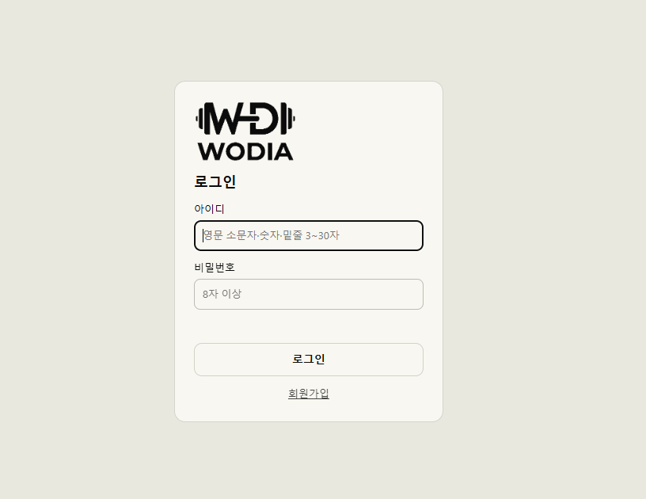
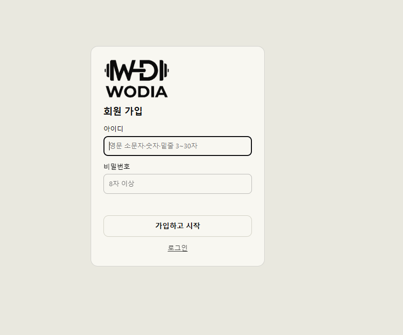
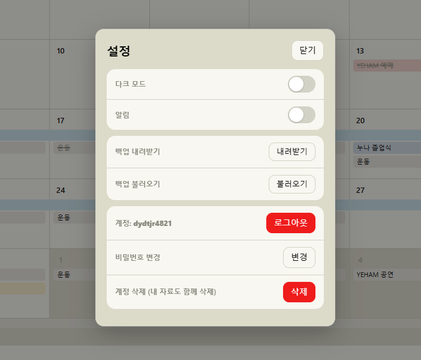
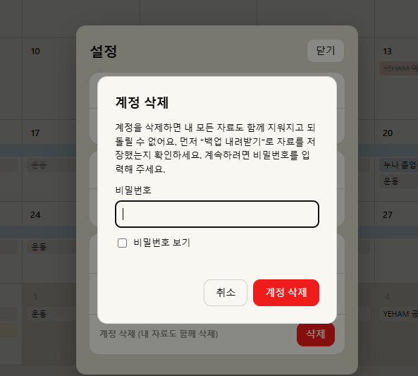
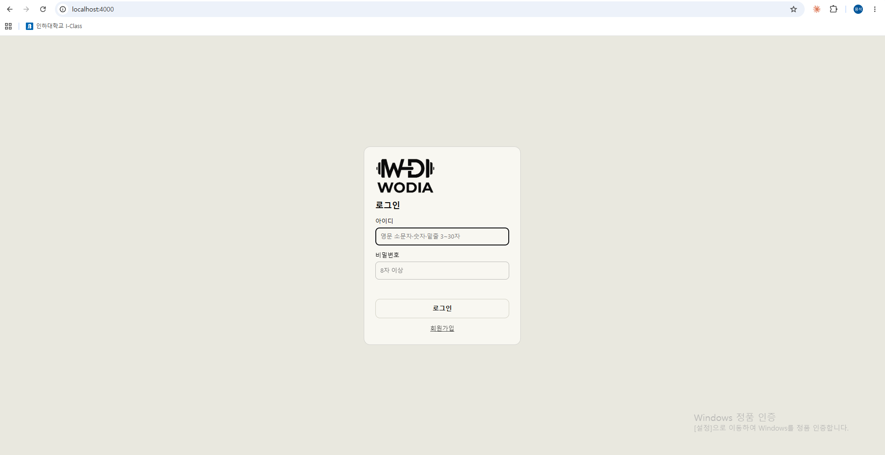

# 과제 7 증거 문서 — 인증·인가와 세션 관리

> 이 문서의 요청·응답은 **실제로 서버를 띄워 자동 테스트한 결과**를 그대로 옮긴 것입니다(테스트용 계정 alice, bob, 임시 데이터 폴더).
> 비밀번호는 `********`, 세션 값은 앞 6자만 남기고 `…생략`으로 가렸습니다. 해시값은 원문을 알 수 없는 값이라 그대로 적었습니다.
> `[직접 채우기]` 표시는 본인이 해야 하는 부분입니다(맨 아래 체크리스트 참고).

## 0. 제출 정보
- 앱 이름: Plan-Do-See 다이어리 2 (WODIA) — 6번 다이어리를 확장
- 실행: `npm install` → `node server.js` → http://localhost:3000 (첫 화면은 로그인 화면)
- 결과물 주소(공개 URL): [직접 채우기] / 소스 저장소 주소: [직접 채우기]
- 이어서 사용한 최종 6번 결과: [직접 채우기 — 6번 제출 주소] / 고정한 T06 commit: [직접 채우기]

---

## 1. 인증 구현 방식과 선택 이유 (카드 1)
**선택: 라이브러리 — `bcryptjs` 3.0.3** (비밀번호 해시만 라이브러리, 로그인 상태 관리는 직접 작성)

| 후보 | 선택 여부 | 이유 |
|---|---|---|
| 라이브러리 (bcryptjs 3.0.3) | **선택** | 비밀번호 해시·솔트처럼 틀리기 쉬운 부분을 검증된 코드에 맡김. 순수 자바스크립트라 Windows에서도 설치 문제가 없음 |
| 직접 구현(Node 내장 crypto) | 선택 안 함 | 해시를 직접 짜면 솔트·비교 방식에서 실수할 위험이 있어, 검증된 라이브러리가 더 안전하다고 판단 |
| 외부 인증 서비스(구글 로그인 등) | 선택 안 함 | 비밀번호를 서비스가 관리해서 내 DB에 해시 저장 증거를 낼 수 없고, OAuth 로그인은 "로그인·OAuth 없이 열려야 하는" 제출 조건과 충돌 |

- 직접 만든 부분(그 사실을 그대로 밝힘): 세션 발급·만료·무효화, 가입·로그인·로그아웃 API, 계정별 자료 분리. 비밀번호 해시 계산은 bcryptjs 가 함.

## 2. 증거 — 실제 요청과 응답
## [카드 1] 가입 · 로그인 · 로그아웃 · 비로그인 접근
| 항목 | 요청 | 결과 |
|---|---|---|
| 가입(새 계정) | POST /api/auth/register {"username":"alice","password":"********"} | 201 {"user":{"id":1,"username":"alice"},"legacy_claimed":false} · Set-Cookie: sid=TuaG63…생략; HttpOnly; SameSite=Lax; Max-Age=604800 |
| 가입(두 번째 계정) | POST /api/auth/register {"username":"bob","password":"********"} | 201 {"user":{"id":2,"username":"bob"},"legacy_claimed":false} |
| 같은 아이디로 두 번 가입 | POST /api/auth/register {"username":"alice",…} | 409 이미 사용 중인 아이디입니다 |
| 짧은 비밀번호 | POST /api/auth/register {"password":"***"} | 400 비밀번호는 8자 이상이어야 합니다 |
| 로그인 | POST /api/auth/login | 200 {"user":{"id":1,"username":"alice"}} |
| 아이디 O · 비밀번호만 틀림 | POST /api/auth/login | 401 아이디 또는 비밀번호가 올바르지 않습니다 |
| 아이디 자체가 없음 | POST /api/auth/login | 401 아이디 또는 비밀번호가 올바르지 않습니다 |
| 두 문구가 같은가 | | **같다** |
| 로그인 없이 자료 요청 | GET /api/tasks (쿠키 없음) | 401 로그인이 필요합니다 (자료 없음) |
| 로그인 없이 화면 주소(/) 열기 | GET / | 200, HTML 안에 자료 없음: true → 화면 스크립트가 /api/auth/me 401 을 받고 로그인 화면(회원 가입·로그인 폼)만 표시 |
| 로그아웃 | POST /api/auth/logout | 200 {"ok":true} · Set-Cookie: sid=; Max-Age=0 |

## [카드 2] 비밀번호 저장 (users 테이블, 입력한 비밀번호는 같음)
| id | username | password_hash (DB에 저장된 값) |
|---|---|---|
| 1 | alice | `$2b$10$paOpUyygm3lqZpp9I7D2nuv4cZZB7najKWdI919xrC13yJBV/MpDi` |
| 2 | bob | `$2b$10$zJF3KfKSS9Sf99Z5l.0hp.Ng6TFgzcct3X2/SebQtJJE4/95Nka7e` |
- 같은 비밀번호로 만든 두 계정의 저장값이 서로 다른가: **다르다**
- 저장값에 입력한 비밀번호 원문이 들어 있는가: **없다**
- 알고리즘: `$2b$10$` = bcrypt, 비용 10, 솔트는 해시 앞 29자에 계정마다 따로 들어 있음
- 서버 로그(stdout/stderr) 전체에 비밀번호 원문이 있는가: **없다** (서버 로그 36자: "Plan-Do-See → http://localhost:3190")

## [카드 3] 세션 상태 · 만료 · 로그아웃 뒤 거절 (같은 주소 GET /api/tasks, 같은 방식, 같은 쿠키 값 sid=NudPUK…생략)
| 시점 | 응답 |
|---|---|
| 로그인한 상태 | 200 성공, 이벤트 3건 |
| 로그아웃한 뒤 (달라진 것은 로그아웃 여부뿐) | 401 로그인이 필요합니다 |
- 만료: {"user":{"id":1,"username":"alice"},"session_expires_at":"2026-11-25T12:19:47+09:00","session_ttl_days":7} (발급 후 7일, 서버 DB sessions.expires_at 과 쿠키 Max-Age=604800 모두 적용)
- 서버에 저장되는 것: 쿠키 값의 SHA-256 해시만 (예: 3fa01562dc…생략 , 64자). 쿠키 원문은 DB에 없음
- 비밀번호 변경 → 변경 전에 발급된 sid=6_ej0c…생략: **401** (로그인이 필요합니다) / 변경 때 새로 발급된 sid=GHSFHC…생략: 200
- 옛 비밀번호로 로그인: 401 아이디 또는 비밀번호가 올바르지 않습니다

## [카드 4] 다른 계정 자료 접근 (계정 2개: alice, bob / 비밀번호 마스킹)
- alice 자료: 이벤트 3건 (id 1 …), bob 자료: 이벤트 3건 (id 1000001 …). 두 계정의 이벤트 id 범위가 겹치는 개수: 0
| 시도 | 요청 | 거절 응답 |
|---|---|---|
| alice → bob의 이벤트 1000001 | 읽기 GET /api/tasks/1000001 | 404 이벤트가 없습니다 |
| | 수정 PUT /api/tasks/1000001 | 404 이벤트가 없습니다 |
| | 삭제 DELETE /api/tasks/1000001 | 404 이벤트가 없습니다 |
| bob → alice의 이벤트 1 | 읽기 GET /api/tasks/1 | 404 이벤트가 없습니다 |
| | 수정 PUT /api/tasks/1 | 404 이벤트가 없습니다 |
| | 삭제 DELETE /api/tasks/1 | 404 이벤트가 없습니다 |
- 거절 전후 자료 건수: alice 3 → 3, bob 3 → 3 (같음, 반대편에 새로 생긴 자료 없음: true)
- bob 이 요청 주소·헤더에 alice 를 적어서 보냄 (GET /api/tasks?user=alice&owner=1, X-User-Id: 1): 200, 3건, 그 중 alice 이벤트 0건 → bob 자신의 자료만 돌아옴
- bob 이 요청 본문에 owner=alice 를 적어 이벤트 생성: 201, 생성된 id 1000004 (bob 범위), alice 목록에 생긴 것: false
- 로그인하지 않은 채 직접 요청: GET /api/tasks/1 → 401, DELETE /api/tasks/1 → 401, GET /api/export?scope=all → 401
- 목록 응답에 다른 계정 자료가 있는가: alice 목록에 bob 이벤트 0건, bob 목록에 alice 이벤트 0건
- bob 의 내보내기(GET /api/export?scope=all) 200: 이벤트 4건, alice 이벤트 0건, 파일 1개
- 다른 사이트(Origin: http://evil.example)에서 보낸 쓰기 요청: 403 허용되지 않은 요청 출처입니다

## [카드 5] 계정 삭제
- POST /api/auth/delete {"password":"********"} → 200 {"ok":true} · 삭제 뒤 같은 쿠키 → 401 · bob 의 자료 파일(users/2.db) 남아 있는가: false

### 6번 자료 이관 (6번에서 입력한 본인 기록이 본인 계정으로 이관됨)
가장 먼저 가입한 계정이 6번 DB를 이어받습니다(원본 파일은 그대로 둠). 테스트 결과:
```
6번 DB(data/pds.db):    plans 2, tasks 63, runs 6, diary 0, ddays 1
내 계정 DB(users/1.db): plans 2, tasks 63, runs 6, diary 0, ddays 1   ← 같은 건수로 이관됨
```
- 실제 제출용 계정(`dydtjr4821`)에서의 이관 결과: 가입 직후 달력에 6번에서 입력한 기록(이벤트 63건, 실행 기록 6건)이 그대로 보인다 → 아래 「화면 캡처」 3번 참고.

---

## 3. 소스 위치 (거절·인증을 만드는 곳)
| 무엇 | 위치 |
|---|---|
| 비로그인 요청 거절(401)과 사용자 DB 선택 | `server.js:656-658` (`currentSession` → `userDb(sess.user.id)`) |
| 다른 계정 자료 접근 거절의 근본 원인 | `server.js:823-840` — 계정마다 자료 DB 파일이 따로이고(`data/users/<번호>.db`), 새 계정은 이벤트 번호가 겹치지 않게 시작(`AUTO_TABLES`, `offset`). 요청한 번호가 내 DB에 없으면 `getTask`(`server.js:295`)가 404 |
| 가입 / 비밀번호 해시 | `server.js:894-908` (`bcrypt.hash(password, 10)`, 899번 줄) |
| 로그인 / 같은 오류 문구 / 아이디 없을 때도 같은 계산 시간 | `server.js:852-853, 910-920` (`BAD_LOGIN`, `DUMMY_HASH`) |
| 세션 발급(무작위 값, 서버에는 해시만), 만료 7일 | `server.js:849, 865-871` |
| 세션 확인(만료 시각 검사) | `server.js:872-879` |
| 로그아웃(서버에서 세션 삭제) | `server.js:922-926` |
| 비밀번호 변경 → 이전 세션 전부 삭제 | `server.js:927-937` |
| 계정 삭제 → 로그인 정보·세션·내 자료 파일 삭제 | `server.js:938-949` |
| 다른 사이트에서 온 쓰기 요청 차단 | `server.js:652-653` |
| 로그인·가입 화면 / 비로그인 시 자료 요청 안 함 | `public/app.js:21-41, 761-764` |
| 계정 설정(로그아웃·비밀번호 변경·계정 삭제 버튼, 앱 안 입력 창) | `public/app.js:43-92` (`askDialog`, `accountAction`) 및 설정 시트 |

## 4. 비밀키·비밀값이 코드에 없다는 근거
- 세션 값은 요청마다 `randomBytes(32)`로 새로 만든 무작위 값이라 **서명용 비밀키가 필요 없음**(JWT를 쓰지 않음).
- 쿠키 값은 `HttpOnly`(자바스크립트에서 읽을 수 없음), `SameSite=Lax`. URL·쿼리에는 세션 값이 들어가지 않음.
- 확인 방법: `node_modules`를 뺀 소스에서 검색
```bash
grep -rniE "secret|api_key|token|password *[:=] *['\"]" server.js public/ README.md package.json
```
- 검색 결과: 모두 `server.js`의 **변수·컬럼 이름**(`token_hash`, `const token = randomBytes(32)…`, `const password = typeof b.password…`)과 코드 줄이고, 비밀번호·키·토큰의 **값(문자열 상수)은 없다**. `public/`, `README.md`, `package.json`에서는 일치 항목이 없다. (비밀키가 필요 없는 구조라 `secret`·`api_key`는 한 건도 없음)
- 같은 방식으로 테스트에 쓴 비밀번호 원문을 소스·문서에서 검색했을 때 일치하는 것이 없다. (없는 아이디의 로그인 시간을 맞추는 가짜 해시도 고정 문자열이 아니라 서버를 켤 때마다 무작위로 만든 값을 쓴다: `server.js:853`)
- `data/` 폴더(DB)는 Git에 올리지 않기: `.gitignore` 에 `data/`, `node_modules/` 추가.

---

## 5. 인증 구현 설명서 (6항목)

### ① 무엇으로 붙였나
6번 다이어리(Node.js + 내장 SQLite) 위에 `bcryptjs 3.0.3`(비밀번호 해시)을 붙이고, 아이디·비밀번호 가입/로그인, 쿠키 세션, 계정별 자료 분리를 직접 작성했다. 계정 정보는 `data/auth.db`, 다이어리 자료는 계정마다 `data/users/<번호>.db`에 따로 저장한다.

### ② 왜 그걸 골랐나
비밀번호 해시는 직접 만들면 틀리기 쉬워 검증된 라이브러리(bcryptjs)에 맡겼다. 외부 인증 서비스는 비밀번호 저장 증거를 낼 수 없고 OAuth 금지 조건과 맞지 않아 제외했다. 세션은 JWT 대신 서버 DB에 저장하는 방식으로 해서, 로그아웃·비밀번호 변경 때 즉시 무효화할 수 있고 서명용 비밀키도 필요 없게 했다.

### ③ 어디를 어떻게 고쳤나 (흐름별 소스 위치)
- **가입:** 화면 `public/app.js:21` → `POST /api/auth/register` → `server.js:894` 에서 아이디·비밀번호 검증 후 bcrypt 해시 저장, 세션 발급
- **로그인:** `server.js:910` — 아이디가 없어도 같은 시간 계산, 실패 문구 동일, 5회 연속 실패 시 1분 잠금
- **로그아웃:** `server.js:922` — 서버의 세션 행 삭제 + 쿠키 만료
- **자료 조회:** `server.js:652-658` — 세션으로 사용자를 찾고 그 사용자의 DB 파일만 연다. 다른 계정 파일에는 닿을 수 없다.

### ④ 안 열리는 것을 확인한 기록 (성공 요청 + 거절 요청 5가지)
| # | 확인 | 성공한 요청 | 거절된 요청 |
|---|---|---|---|
| 1 | 비로그인 접근 | 로그인 후 `GET /api/tasks` → 200 | 쿠키 없이 같은 요청 → 401 |
| 2 | 로그아웃 후 이전 세션 | 로그인 상태 `GET /api/tasks` → 200 | 로그아웃 뒤 같은 쿠키 → 401 |
| 3 | 다른 계정 자료(읽기·수정·삭제 양방향) | 자기 이벤트 조회 → 200 | 남의 이벤트 번호 → 404 (6건 모두) |
| 4 | 비밀번호 변경 후 이전 세션 | 변경 때 새로 받은 세션 → 200 | 변경 전 세션 → 401 |
| 5 | 다른 사이트에서 온 쓰기 요청 | 같은 출처 요청 → 200 | `Origin: http://evil.example` → 403 |
(위 증거는 2번 섹션의 실제 응답 참고)

### ⑤ AI와 나
> 아래는 작업 과정에서 실제로 있었던 일을 바탕으로 쓴 초안이다. 제출 전에 본인이 사실과 맞는지 확인한다.

- **AI에게 맡긴 일:**
  - 가입·로그인·로그아웃·세션 발급과 만료·무효화 코드 작성(`server.js`)
  - 계정마다 자료 DB를 나누는 구조와 6번 자료 이관 코드 작성
  - 로그인·가입 화면, 설정의 계정 메뉴, 비밀번호 변경·계정 삭제 입력 창 작성(`public/app.js`, `public/app.css`)
  - 두 계정 교차 접근, 로그아웃·비밀번호 변경 뒤 세션 거절 등을 확인하는 자동 테스트 실행과 결과 정리
  - 증거 문서·기획서·5일 관찰 시작 기록 초안 작성
- **내가 직접 판단한 일:**
  - 인증 구현 방식으로 라이브러리(bcryptjs)를 고른 것
  - 구글 로그인 같은 외부 인증 서비스를 쓰지 않기로 한 것, 비밀번호 재설정·아이디 찾기를 이번에는 만들지 않기로 한 것(복구 코드·이메일 방식의 장단점을 듣고 결정)
  - 6번 다이어리를 복사해 원본(`work_6`)은 그대로 두고 7번을 진행하기로 한 것, 6번에서 지운 파일·기능을 7번에도 똑같이 맞추게 한 것
  - 화면 수정 요청: 로그인 화면 링크를 "회원가입"만 남기기, 로그아웃·삭제 버튼을 빨간색으로 하기, 깨진 로고 고치기, 삭제 입력 창이 앱 안 브라우저에서 안 뜨는 문제 제보
  - 5일 관찰의 질문·지표·계획 규칙 확정, 앱을 켤 수 없는 금·토·일을 뺀 5일 일정 결정
  - 6번 자료 이관, 로그인·삭제 창 화면 캡처와 최종 결과 확인(직접 가입해서 6번 기록이 보이는지 확인)
- **AI 제안을 따르지 않은 일:**
  - AI는 외부 패키지 없이 Node 내장 암호 기능으로 직접 구현하는 방식을 추천했으나, 검증된 라이브러리 `bcryptjs`를 쓰는 방식을 선택했다.
  - AI는 비밀번호 재설정을 **복구 코드 방식**으로 만들 것을 추천했으나, 설정 비용 때문에 재설정 기능 자체를 만들지 않기로 했다.
  - (반대로, 사용자가 처음 요청한 "아이디만 입력하면 비밀번호 재설정"은 남의 계정을 가로챌 수 있다고 AI가 반대해 만들지 않았다.)

### ⑥ 아직 못 막은 것 (구현하지 않은 것)
1. **무차별 대입 공격(brute force):** 아이디별 5회 실패 시 1분 잠금만 있다. IP별 제한, 계정 영구 잠금, 봇 방지(CAPTCHA)는 없어서, 여러 아이디를 번갈아 시도하거나 서버를 재시작하면(실패 횟수는 메모리에만 저장) 제한이 풀린다. 위험: 약한 비밀번호가 시간을 들여 뚫릴 수 있다.
2. **비밀번호 재설정·아이디 찾기:** 없다. 아이디·비밀번호를 잊으면 계정을 되찾을 방법이 없다. 아이디만으로 재설정하게 하면 남의 계정을 가로챌 수 있고, 복구 코드·이메일 인증은 설정 비용(메일 발송 계정·비밀키 관리, 개인정보 처리) 때문에 이번에는 넣지 않았다. 위험: 계정을 잃으면 그 계정의 자료도 함께 잃는다(다만 내보내기 파일로 미리 백업해 둘 수 있다).
3. **다중 요소 인증(MFA):** 없다. 비밀번호 하나가 뚫리면 계정이 열린다.
4. **감사 로그:** 로그인 성공·실패, 접근 거절을 기록하는 로그가 없어 침해 흔적을 나중에 확인할 수 없다.
5. **HTTPS 강제:** 앱은 `x-forwarded-proto: https` 또는 `COOKIE_SECURE=1`일 때만 `Secure` 쿠키를 쓴다. 배포 환경이 HTTPS가 아니면 세션 쿠키가 평문으로 오갈 수 있다.
6. **세션 목록 관리:** 비밀번호를 바꾸면 모든 세션이 지워지지만, 내 로그인 기기 목록을 보고 개별로 끊는 기능은 없다.
7. **비밀번호 복잡도 검사:** 길이(8~72바이트)만 확인하고 흔한 비밀번호 목록 검사는 하지 않는다.

---

## 6. 짧은 사용법
- **① 어디서 시작:** 주소를 열면 로그인 화면이 나온다.
- **② 세 단계:** (1) 로그인 화면 아래 "회원가입"에서 아이디·비밀번호로 가입 → (2) 달력에서 일정을 완료로 처리하며 기록 → (3) 설정(⚙)에서 백업 내려받기 / 로그아웃.
- **③ 통과 기준:** 가입 후 달력이 보이고, 로그아웃하면 로그인 화면으로 돌아가며, 다시 로그인하면 내 기록이 그대로 있다.
- **④ 안 될 때:** 로그인 화면에 빨간 글씨로 "아이디 또는 비밀번호가 올바르지 않습니다"가 보이고, 5회 연속 실패하면 "1분 뒤에 다시 시도"가 보인다. 세션이 끝나면(로그아웃·7일 경과) 자동으로 로그인 화면이 나온다.

---

## 7. 내보내기 · 계정 삭제
- **내 자료 파일 하나로 내보내기:** 설정(⚙) → 백업 내려받기 → `pds-all.json` 1개 (`GET /api/export?scope=all`). 위 증거에서 bob의 내보내기에는 alice 자료가 0건. (새 계정은 빈 상태로 시작하므로 테스트에서는 계정마다 계획 1개·이벤트 3개를 직접 만들어 사용)
- **계정 삭제:** 설정(⚙)에서 빨간 「삭제」 버튼을 누르면 앱 안에 **「계정 삭제」 확인 창**이 뜬다. 창에는 "계정을 삭제하면 내 모든 자료도 함께 지워지고 되돌릴 수 없어요. 먼저 '백업 내려받기'로 자료를 저장했는지 확인하세요. 계속하려면 비밀번호를 입력해 주세요."라는 안내와 **비밀번호 칸**(기본은 가려짐, 「비밀번호 보기」로 확인 가능), 「취소」·「계정 삭제」 버튼이 있다. 이 창에서 비밀번호까지 맞게 입력해야만 삭제되며, 비밀번호가 틀리면 창 안에 "비밀번호가 올바르지 않습니다"가 표시되고 삭제되지 않는다(취소·Esc로 닫으면 아무 일도 일어나지 않음). 삭제되면 로그인 정보·세션·내 자료 파일이 함께 지워진다(위 [카드 5] 증거: 삭제 뒤 같은 쿠키 → 401, 자료 파일 없음).
  - 화면 캡처: 아래 「화면 캡처」 4번(설정 화면: 로그아웃·삭제 버튼)과 5번(「계정 삭제」 확인 창, 비밀번호 칸 비어 있음).
  - 실제 계정으로는 삭제 버튼을 누르지 않고 창만 열어 캡처한 뒤 「취소」를 눌렀다(삭제 시 6번 자료도 함께 지워짐). 삭제가 실제로 일어나는 증거는 위 [카드 5]의 테스트 계정 결과를 사용한다.

---

## 화면 캡처 (실제 화면, 제출용 계정 `dydtjr4821`, 주소 `http://localhost:4000`)
| # | 캡처 | 보여 주는 것 |
|---|---|---|
| 1 |  | 앱의 첫 화면은 로그인 화면(아이디·비밀번호·로그인 버튼·회원가입 링크). 로그인하기 전에는 자료가 보이지 않음 |
| 2 |  | 가입 화면(아이디 영문 소문자·숫자·밑줄 3~30자, 비밀번호 8자 이상) |
| 3 |  | 가입·로그인 직후 달력에 6번 다이어리 기록이 그대로 보임 = 6번 기록이 본인 계정으로 이관됨 |
| 4 |  | 설정: 로그인한 계정 표시, 빨간 「로그아웃」·「계정 삭제」 버튼, 「비밀번호 변경」 |
| 5 |  | 「삭제」를 누르면 뜨는 확인 창: 되돌릴 수 없다는 안내, 비밀번호 칸(비어 있음), 「비밀번호 보기」, 「취소」·「계정 삭제」 |
| 6 |  | 로그아웃 뒤 같은 주소(`localhost:4000`, 주소창에 보임)에서 자료 대신 로그인 화면이 나옴 |
- **비밀번호 변경:** 설정(⚙) → 「변경」 → 현재 비밀번호 + 새 비밀번호 + 새 비밀번호 한 번 더(두 칸이 다르면 "서로 다릅니다"가 표시되어 잘못 입력하는 경우를 막음). 변경하면 다른 기기의 로그인은 모두 풀린다(위 [카드 3] 증거).

---

## 8. 5일 사용 기록 (직접 채우기)
관찰 질문·지표·단위·규칙은 `5일 관찰 시작 기록.md` 참고. 1일차에 고정한 것은 바꾸지 말고, 계획 규칙 변경은 **2일차 기록 뒤 ~ 3일차 기록 앞**에 한 번만.

| 날짜 (Asia/Seoul) | 규칙 | 하루 완료 과제 수(개) | 메모(이상값·결측 이유 등) |
|---|---|---|---|
| 1일차 2026-11-19 (목) | 영어 09:00 (변경 전, 이날 새로 추가) | 2 (운동 1 + 영어 공부 1) | 영어 공부는 09:00 시작·60분으로 기록. 완료 처리는 09:52에 해서 종료 시각(10:00)이 처리 시각보다 8분 뒤로 남아 있음. 처음 완료 처리(소요 0분)는 취소했고 이력에 「취소됨」으로 남음 |
| (참고) 2026-11-20 (금) — **5일에 미포함, 소급 기록** | 영어 09:00 | 3 (누나 졸업식, 운동, 영어 공부) | 이 날 일정을 **다음 날 11/21 17:16에 나중에 체크**함(앱에 입력 시각이 그대로 남아 있음). 입력한 날짜가 11/21이라 서로 다른 입력 날짜 5일에 넣지 않고 참고용으로만 둠 |
| **규칙 변경** 2026-11-21 17:19 (앱의 일정 수정 기록 기준) | 영어 공부 시각 09:00 → 10:00 (11/21 이후 반복 일정 전체) | — | 변경 시점이 11/21 운동 기록(17:18) 직후, 영어 기록(17:19) 직전이라 **변경 전 기록은 1일차(11/19) 하루뿐**임 |
| 2일차 2026-11-21 (토) | 영어 10:00 (변경 후) | 2 (운동 1 + 영어 공부 1) | 운동 14:00~15:30, 영어 10:00~11:00. 17:18~17:19에 입력(같은 날). 입력 중 시작 시각을 잘못 넣은 기록 몇 건은 취소하고 다시 입력함(이력에 「취소됨」으로 남음) |
| 3일차 2026-11-22 (일) | 영어 10:00 (변경 후) | 2 (운동 1 + 영어 공부 1) | 운동 10:00~11:30, 영어 10:00~11:00. 11:35에 입력(같은 날) |
| 4일차 2026-11-23 (월) | 영어 10:00 (변경 후) | 2 (운동 1 + 영어 공부 1) | 운동 06:30~08:00(90분), 영어 10:00~11:00(60분). 11:22에 입력(같은 날) |
| 5일차 2026-11-24 (화) | 영어 10:00 (변경 후) | 1 (운동 1) | 운동 06:30~08:00(90분). 영어 공부는 하지 않아 「건너뜀」으로 기록(사유: 컨디션이 좋지 않음). 처음에 영어 공부를 완료로 잘못 체크했다가 10:11에 취소하고 건너뜀으로 바꿈(이력에 「취소됨」으로 남음). 이상값 아님(0개·15개 초과 아님) |

> 앱 데이터에 영어 공부 일정이 없어서 2026-11-19에 새로 추가하고 이날을 1일차로 시작했다(11/18은 앱에 완료 기록이 없어 제외). 11/20~22(금·토·일)는 집 노트북으로 기록했다. 11/20 일정은 11/21에 나중에 체크했기 때문에 **서로 다른 실제 입력 날짜 5일**(11/19, 11/21, 11/22, 11/23, 11/24)을 기준으로 삼고 11/20은 소급 기록(참고)으로만 남긴다.

- 5일 합계(손으로 더한 값): 2 + 2 + 2 + 2 + 1 = 9 / 화면에 보이는 합계: [직접 채우기 — 앱 회고 화면과 맞춰 보기] / 5일 평균(소수 첫째 자리): 9 ÷ 5 = 1.8
- 변경 전 하루 평균: 1일차 하나뿐(2.0, 참고로 11/20 소급분은 3) → 변경 후(2~5일차) 하루 평균: (2 + 2 + 2 + 1) ÷ 4 = 1.75 → 1.8 → 결과: 나빠짐(2.0 → 1.8). 이유 한 줄: 5일차에 컨디션이 좋지 않아 영어 공부를 하지 못해서이고, 영어 공부 시각을 10시로 늦춘 효과라고 보기는 어렵다.
- **한계(사실대로):** 영어 공부 시각을 바꾼 시점이 2일차 기록 도중이라 변경 전 비교 기간이 하루뿐이다. 계획 규칙 변경이 「2일차 기록 뒤 ~ 3일차 기록 앞」이어야 한다는 약속은 이 기록에서는 지켜지지 않았다(원래 일정은 11/20 기록 직후 변경이었으나, 11/20 일정을 11/21에 소급 체크하면서 어긋남).

## 9. 마지막에 본인이 확인할 체크리스트
- [ ] `[직접 채우기]` 표시를 모두 채웠는가
- [ ] 가입·로그인·로그아웃·로그인 화면 캡처를 붙였는가
- [ ] 문서·화면·소스 어디에도 실제 비밀번호·세션 값 원문이 없는가
- [ ] 제출한 모든 URL이 시크릿 창에서 로그인·초대 없이 열리는가
- [ ] 5일 기록을 서로 다른 실제 날짜로 남기고, 합계·평균을 손으로 맞춰 봤는가
